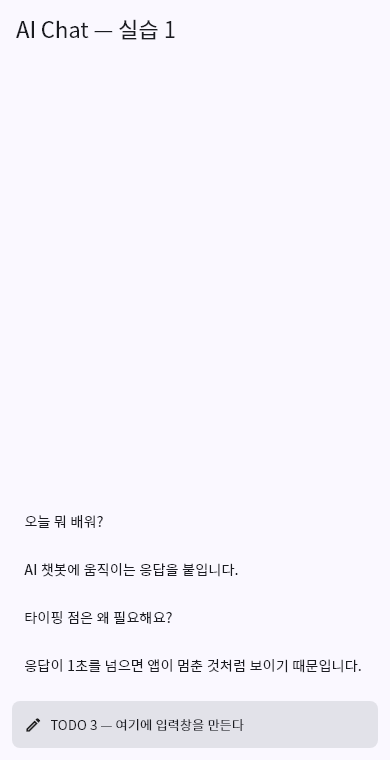
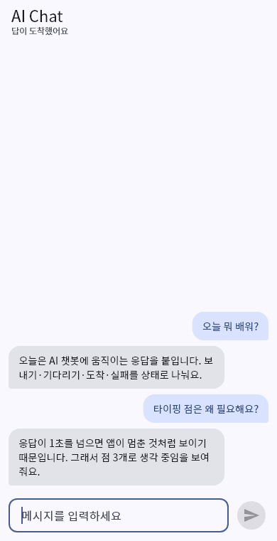
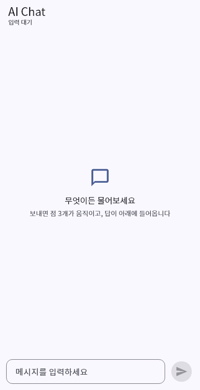
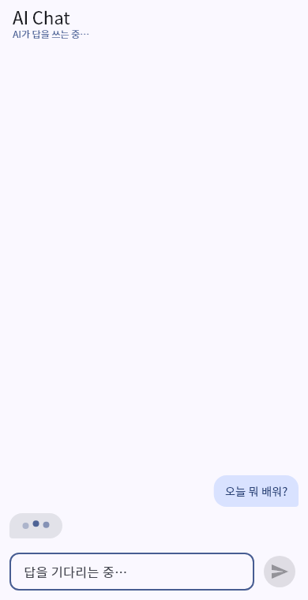
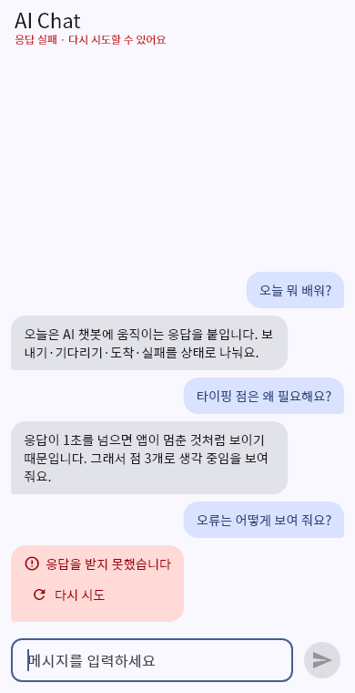

# 11주차 포트폴리오 — AI 챗봇 + 애니메이션

> 쓰는 법: "애니메이션 넣었다"가 아니라 **어떤 상태에서 왜 움직였고, 없으면 무엇을 잃는지**를 쓴다.

| 칸 | 내용 |
|---|---|
| **1. 만든 것** | 챗봇 5상태(idle · sending · typing · done · error)를 `ChatStatus`로 나누고, 상태마다 다른 화면을 보여 준다. 전송하면 내 말풍선이 삽입되고, 목록 맨 아래 "답 대기" 칸에 점 3개가 움직이다가, 답이 오면 그 칸이 제자리에서 답 말풍선으로 자란다. 오류는 같은 자리에 오류 말풍선 + 다시 시도로 남는다. 앱은 프록시(`:8787`)만 호출하고 키는 들고 있지 않다. |
| **2. 막힌 것** | ① 답이 "툭" 나타나 새 말풍선이 생긴 걸 놓쳤다(변화맹시). ② `reverse: true` 목록에서 `insertItem(length - 1)`로 넣었더니 새 메시지가 맨 위에 들어갔다. ③ 점 3개를 목록 밖(입력창 위)에 두었더니, 답이 올 때 점이 사라지는 순간 목록이 아래로 툭 떨어졌다가 다시 올라갔다. ④ 오류가 말풍선과 입력창 위 줄에 두 번 나오고, 둘이 동시에 움직였다. ⑤ 긴 답은 마지막 줄부터 보여 위로 올려 읽어야 했다. ⑥ 웹에서 한글을 처음 입력하면 잠깐 □로 보였다. |
| **3. 해결** | ① `insertItem` 250ms(Size + Fade)로 "방금 도착"을 눈으로 따라가게 했다. ② reverse 목록은 화면 index 0이 최신이므로 항상 `insertItem(0)`. ③ 점을 목록 안의 한 칸으로 옮기고, 답이 오면 **같은 id**의 말풍선으로 바꿔 `AnimatedSize`로 제자리에서 자라게 했다 → 튐 없음(테스트로 매 프레임 확인). 점은 최소 400ms 보여 깜빡임을 막았다. ④ 오류는 말풍선 한 곳에만 — **한 번에 하나**. ⑤ 답이 화면보다 길면 다 자란 뒤 첫 줄로 스크롤(NN/g 7번). ⑥ Noto Sans KR을 앱에 넣어 시작 전에 로드. Reduce Motion이면 시간을 모두 0으로 두고, 점 대신 "답을 작성하는 중" 문구로 정보를 남겼다. |
| **4. 다음** | 12주 설문 앱에서 폼을 상태 기계로 만들고 초안 저장·복원을 익힌다. 14주에는 이 `ChatState`를 그대로 Provider로 옮긴다. 스트리밍 응답이 오면 점 3개가 여전히 필요한지(첫 토큰 전까지만?) 확인해 본다. |
| **5. 증거** | PR: [xide-projext/…/pull/7](https://github.com/xide-projext/yonsei_gai3008_w11_lab1_chat_ui/pull/7) · 커밋: [PR의 커밋 목록](https://github.com/xide-projext/yonsei_gai3008_w11_lab1_chat_ui/pull/7/commits) · 전/후 캡처: 아래 · 1분 구술 녹음: `<링크>` · `flutter analyze` 0건 · `flutter test` 15개 통과 |

## 전/후 캡처

| 전 — 스타터 | 후 — 대화 |
|---|---|
|  |  |
| 말풍선 없음 · 입력창 없음(TODO) · 상태 표시 없음 | 좌우 말풍선 · 입력창 · 앱바에 지금 상태 |

| 후 — 빈 상태 (idle) | 후 — 점 3개 (typing) | 후 — 오류 (error) |
|---|---|---|
|  |  |  |
| "무엇이든 물어보세요" — 피드포워드 | 전송 버튼 잠금 · "AI가 답을 쓰는 중…" | 오류 말풍선 + 다시 시도 · 입력은 계속 가능 |

캡처는 실제 앱 위젯을 Flutter 렌더러로 그린 것이다 — `flutter test tool/capture_screenshots_test.dart --update-goldens`로 다시 만들 수 있다.

## 1분 구술 뼈대

1. **이 응답은 어디서 오나요?** `ChatPage._send()` → `AiClient.chat()` → 프록시 `localhost:8787/api/chat` → AI API. `await`로 기다리는 동안 상태는 sending → typing.
2. **응답 전에 무엇을 보여 주나요?** typing 상태에서 점 3개 칸, 앱바 "AI가 답을 쓰는 중…", 전송 버튼 잠금(연타 방지).
3. **왜 이 애니메이션인가요?** 1초를 넘는 대기에 표시가 없으면 앱이 멈춘 것처럼 보인다(점 3개). 삽입이 없으면 새 말풍선을 놓친다(250ms 삽입). 점이 같은 자리에서 답으로 자라 시선이 한 곳에 머문다. 이 움직임들은 Reduce Motion에서 꺼지고, 꺼져도 정보는 남는다.
